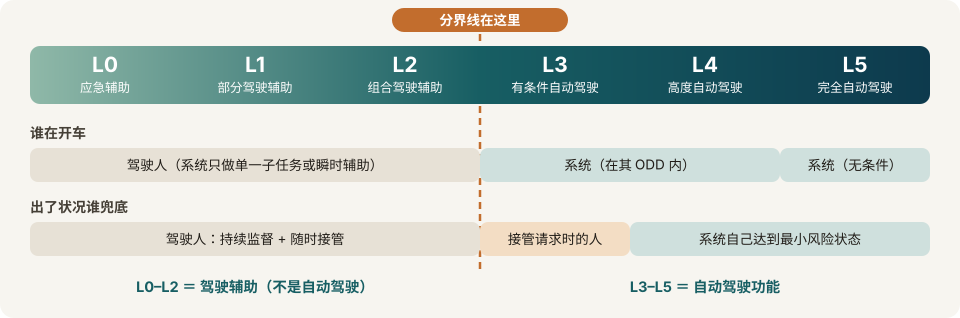

<small>Facts follow the Chinese original.</small>

> [!info] This page's task
> Pin down the definitions. Levels are the concept most easily substituted by marketing language — first look at what the standard itself says, then at how each country approves them and who is responsible when something goes wrong. Information as of 2026-11-11.

## SAE J3016: What the levels actually divide

The levels are based **not on "how intelligent" a system is**, but on three things: who performs the dynamic driving task (DDT, including lateral/longitudinal control and object and event detection and response, OEDR), who is responsible for DDT fallback (reaching a minimal risk condition when the system fails or exceeds its limits), and the scope of the operational design domain (ODD). Active safety systems (such as AEB) are not within this classification.

Version note: the long-current version is J3016_202104 (the April 2021 edition); SAE now also lists **J3016_202609** (the September 2026 edition). When citing it, use the [SAE Mobilus page](https://saemobilus.sae.org/standards/j3016_202609-taxonomy-definitions-terms-related-driving-automation-systems-road-motor-vehicles) as the authority, and do not write "latest = 2021" anymore.

*The levels ask only three questions: who drives, who provides the fallback, and over how large a scope (ODD). The line between L2 and L3 is the dividing line between "assisting a person" and "replacing a person" (drawn by this site).*

| Level | Who drives | Who provides the fallback | Characterization |
|---|---|---|---|
| L0 | The driver performs the entire DDT; warnings or momentary assistance may be present | Driver | Driver assistance |
| L1 | The system continuously performs a single lateral **or** longitudinal subtask within a limited ODD | The driver performs the rest of the DDT, supervises, and provides the fallback | Driver assistance |
| L2 | The system performs both lateral and longitudinal control | **The driver must still continuously supervise, perform OEDR, and provide the fallback** | Driver assistance |
| L3 | The ADS performs the entire DDT within the ODD | The "fallback-ready user": need not continuously watch the road, but must respond promptly upon receiving a takeover request | Automated driving |
| L4 | The ADS performs the entire DDT within the ODD and provides the fallback itself | The system; no human response is expected | Automated driving |
| L5 | The ADS performs the entire DDT under all conditions a human driver can handle, and provides the fallback | The system; no ODD limits | Automated driving |

The two most common substitutions:
1. **L0–L2 are collectively "driver assistance", not automated driving** — calling an L2 function "autonomous driving" does not hold under the levels. Tesla FSD's regulatory characterization has always been L2; for its own filings, see [[companies/tesla|Tesla]].
2. **"L2+/L2.5/L2.9" are not J3016 terms**: §8.3 of the standard explicitly prohibits fractional level expressions. Such wording is entirely a marketing invention. Source: [Koopman's guide to using J3016](http://users.ece.cmu.edu/~koopman/j3016/index.html)

## China's national standard: GB/T 40429-2021

Issued on 2021-08-20, effective on 2022-03-01. Its structure corresponds to J3016: levels 0–2 are "driver assistance" (the driver remains the driving subject), and levels 3–5 are "automated driving". The name of each level: 0 Emergency Assistance / 1 Partial Driver Assistance / 2 Combined Driver Assistance / 3 Conditionally Automated Driving / 4 Highly Automated Driving / 5 Fully Automated Driving. Source: [National Public Service Platform for Standards Information](https://openstd.samr.gov.cn/bzgk/std/newGbInfo?hcno=4754CB1B7AD798F288C52D916BFECA34)

## L3 as actually deployed: only a few cars worldwide, all with strict fences

- **Honda Legend (Japan, the world's first type designation)**: received type designation from Japan's Ministry of Land, Infrastructure, Transport and Tourism on 2020-11-11; launched on 2021-03-05, **lease only, limited to 100 units**, for highway congestion scenarios at speeds <50 km/h.
- **Mercedes Drive Pilot (the first international approval under UN-R157)**: received type approval from Germany's KBA under UN Regulation No. 157 on 2021-12-09; in 2023 it received a compliance confirmation in Nevada and a deployment permit from the California DMV, and it went on sale in the US at the end of that year (EQS/S-Class, ≤40 mph). Source: [Mercedes-Benz USA press release](https://media.mbusa.com/news/mercedes-benz-receives-approvals-for-turquoise-colored-automated-driving-marker-lights-in-california-and-nevada)
  - Note: some secondary sources claim Mercedes removed Drive Pilot in the 2026 model-year facelift and "paused" the project in January 2026 — **this has not been confirmed by Mercedes officially**, and this page only records that such reports exist.
- **China's first batch (2025-12-15)**: Batch 401 *Announcement* from MIIT conditionally permitted **the first 2 L3 models** — the Changan-branded SC7000AAARBEV (Deepal SL03, limited road sections in Chongqing, single-lane congestion scenarios, maximum 50 km/h) and the Arcfox-branded BJ7001A61NBEV (Arcfox Alpha S6, limited highway sections in Beijing, maximum 80 km/h), with road-access pilots carried out by two **operating entities**, Changan Vehicle Connectivity and Beijing Chuxing. Note the three limits: conditional, operated by operating entities, and **not sold directly to consumers**. On 2025-12-23, Beijing issued the first batch of dedicated license plates for L3 highway automated driving. Source: [MIIT original text](https://www.miit.gov.cn/xwfb/gxdt/sjdt/art/2025/art_f734c7074580470593d4018742997640.html)
- **Second batch**: on 2026-10-22, an MIIT official confirmed at the World Intelligent Connected Vehicles Conference that "work on the second batch of admission pilots is underway", but did not disclose the automakers, models, or timetable. As of 2026-11-11, the shortlists circulating online are all speculation, and this site does not adopt them. Source: [CnEVPost (2026-10-22)](https://cnevpost.com/2026/10/22/china-advances-2nd-batch-level-3-approvals/)

## Three regulatory frameworks

**The United States: no comprehensive federal automated driving law**
- At the federal level, NHTSA manages vehicle safety standards; driver licensing, traffic rules, insurance, and registration are governed by the states. Congressional AV bills (such as the SELF DRIVE Act) have not become law.
- The typical form of the state patchwork: California is a strong-regulation model of DMV testing/deployment permits + insurance guarantees; Arizona and Nevada are relatively permissive; Texas defines the ADS itself as the "operator" in its legislation. California's suspension of Cruise's permits (2023) and its advertising ruling on Tesla (2025) are both this state authority at work; see [[companies/tesla|Tesla]].
- **The 2025 changes to NHTSA's crash reporting order (SGO 2021-01)**: on 2025-04-24, the third revision was issued together with the Department of Transportation's AV Framework, effective 2025-06-16 — the reporting obligation **was retained but simplified**: the same crash is reported by only one entity, serious-crash reports were merged into a single 5-day window, and the scope of monthly reporting was narrowed. Safety advocates call this a "weakening"; that is a dispute over characterization, to be viewed separately from the factual changes. Source: [NHTSA report to Congress (2025-07)](https://www.nhtsa.gov/document/report-congress-research-and-rulemaking-vehicles-equipped-automated-driving-systems-july)

**Europe: the type-approval route**
- **UN-R157 (ALKS)**: the first L3 regulation at the international level, effective 2021-01-22, initially applicable to highway-type roads at ≤60 km/h, and mandatorily requiring a DSSAD (data storage system for automated driving, i.e. a "black box") — Drive Pilot's German approval was granted under this regulation.
- **Germany's L4 legislation**: the *Automated Driving Act* took effect on 2021-07-28, allowing L4 driverless operation within approved limited areas, with type approval handled by the KBA.
- **EU (EU) 2022/1426**: under the framework regulation, it establishes a unified type-approval procedure for the ADS of fully automated vehicles (L4 type); at this stage it applies only to small-series vehicles.

**China: the pilot-admission route**
- The overall framework is the 2023 four-ministry notice on admission and road-access pilots, with the path "application and selection → product admission → road pilot by a designated entity", overlaid with local operating permits and local regulations (such as the *Beijing Regulations on Automated Driving Vehicles*, in force since 2025). For details, see the policy section of [[market/robotaxi-china|China's Robotaxi Landscape]].

## Liability: the levels themselves are a liability allocation table

- **L0–L2**: the person in the driver's seat is responsible for monitoring and for obeying the law — Tesla's official statements agree with state laws, so the focus of litigation in L2 crashes is always "was the driver supervising" and "did the marketing lead people to believe supervision was unnecessary".
- **L3**: when the ADS is activated, the system performs the DDT, but the fallback-ready user retains the takeover obligation, so liability **is not fully transferred**; one legislative purpose of UN-R157 mandating a DSSAD is precisely to preserve data for post-crash liability attribution.
- **L4**: within the ODD, no human fallback is expected, and the liable party shifts to the operator/system side — which is also why robotaxi operators must be licensed, insured, and subject to reporting obligations.
- Regarding specific statements such as "Mercedes promises to bear liability for crashes while Drive Pilot is activated" and "Honda bears liability while Traffic Jam Pilot is activated": this research found only secondary retellings, and no primary text from a manufacturer or regulator was found, so this page marks them **unverified** and does not present them as statements of fact.

## Related notes

- [[companies/tesla|Tesla]] · [[market/robotaxi-china|China's Robotaxi Landscape]]
- [[regulation/us-eu-rules|US and EU Regulation]] · [[market/consumer-adas|Consumer Smart Driving: Assisted Driving Sold to Car Owners]] · [[history/timeline|Timeline Overview]]
