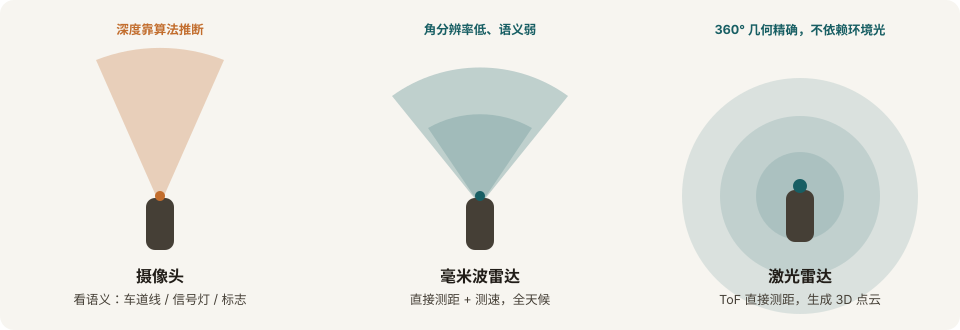

<small>Facts follow the Chinese original.</small>

> [!info] Conventions on this page
> Sources are given for sensor principles and price data; vendors' route statements are labeled "company claims." Information as of 2026-11-11.

## First, pin down the three types of sensor

| Sensor | What it directly measures | Strengths | Weaknesses |
|---|---|---|---|
| Camera | Color, texture, semantics (lane lines, traffic lights, signs) | Highest information density, lowest cost | Depth must be inferred by algorithms; heavily affected by light and weather |
| mmWave radar | Range + Doppler velocity (direct measurement) | All-weather, direct velocity measurement | Low angular resolution, weak semantics |
| Lidar | 3D geometry (ToF time-of-flight direct ranging, d = c·t/2) | Does not depend on ambient light, precise geometry | Cost was once extremely high; semantics must be supplied by algorithms |

Sources: [IBM: What is lidar](https://www.ibm.com/think/topics/lidar); [NI sensor testing review](https://www.ni.com/en/solutions/transportation/adas-and-autonomous-driving-testing/adas-and-autonomous-driving-sensors-and-electronics-test/lidar-role-autonomous-driving-laser-vision-cars.html)

*Schematic of the field-of-view shapes and division of labor of the three sensor types (drawn by this site): the camera is a narrow, far-reaching semantic eye, radar is all-weather ranging and velocity measurement, and lidar is 360° geometric measurement.*

*The world as lidar "sees" it: an orthographic point-cloud map registered from about 23 million points collected over 18 seconds by an Ouster OS1 at an intersection in San Francisco. This is the strongest argument of the "direct ranging" camp — geometry does not need to be guessed. Image: Daniel L. Lu, [CC BY 4.0](https://creativecommons.org/licenses/by/4.0), via [Wikimedia Commons](https://commons.wikimedia.org/wiki/File:Ouster_OS1-64_lidar_point_cloud_of_intersection_of_Folsom_and_Dore_St,_San_Francisco.png).*

The substance of the debate is not "who sees clearly," but: **should depth and geometry be measured directly with expensive hardware, or inferred with cheap sensors + algorithms**. The former spends the cost on hardware redundancy; the latter bets the risk on algorithms and data scale.

## The cost curve: why lidar went from "unaffordable" to an option

- In the DARPA era, the Velodyne HDL-64E was about **75,000 US dollars** (the common narrative corresponds to around 2007; it should not be written as a 2012 price). Source: [Lidar News cost history](https://lidarnews.com/automotive-lidar-cost-history-75000-to-200/)
- The average price of Hesai's ADAS long-range products had fallen below 500 US dollars by 2024–2025, and the new-generation ATX was reported at about the 200 US dollar level; according to a financial-report compilation, Hesai's overall average-price series is about 1,100 US dollars in 2023 → 530 US dollars in 2024 → 260 US dollars in 2025 (the main reason for the decline is the rising share of low-priced ADAS products; this figure has not been checked against first-hand financial reports and is a secondary source). Source: [Financial report compilation](https://www.thesistory.com/HSAI.html)

After the price fell by two orders of magnitude, the core argument from around 2016 that "lidar is too expensive" no longer holds — but that did not end the debate; it only pushed it to the next layer: mass-production vehicles also care about power consumption, styling, calibration, and the data loop.

## The actual configurations of the two camps

**The multi-sensor camp (represented by Waymo)**
- Generation 5 (Jaguar I-PACE): 29 cameras / 5 lidars / 6 mmWave radars.
- Generation 6 Driver (announced 2024-08-19): streamlined to 13 cameras / 4 lidars / 6 mmWave radars + external audio receivers, with overlapping fields of view for each sensor and a maximum range of 500 meters. (The data are a secondary compilation of Waymo's published content.)

**The vision-only camp (represented by Tesla)**
- From 2021, the Model 3/Y shifted to Tesla Vision and removed the front radar; on **2022-10-04** it announced the removal of ultrasonic sensors, starting with the Model 3/Y and expanding to the Model S/X in 2023, replacing them with a vision occupancy network. Sources: [Electrek (2022-10-04)](https://electrek.co/2022/10/04/tesla-moving-away-ultrasonic-sensors-in-favor-tesla-vision/); [Tesla official support page](https://www.tesla.com/en_gb/support/autopilot)
- For its position see [[companies/tesla|Tesla]]; for the operator's position see [[companies/waymo|Waymo]].

**The Chinese market is diverging** (all in company-claim terms)
- **XPeng shifts to vision-only**: the P7+ (2024-10) carries a vision-only solution + an end-to-end large model and removes lidar; the company announced at its 2024 Tech Day that subsequent models would remove lidar across the board. Source: [XPeng official site](https://www.xiaopeng.com/news/company_news/5383.html)
- **Huawei insists on multi-sensor layering**: Qiankun ADS is divided into tiers such as Max / Pro / SE, with the Max version carrying a high-line-count lidar and the SE base version having no lidar; the so-called "ADS Ultra = highway L3 solution" is a vendor claim, not a regulatory determination. Source: [Huawei Qiankun official site](https://auto.huawei.com/cn/ads/)

In the same market and the same period, two leading suppliers are betting in opposite directions — which shows that the divergence has not been adjudicated by engineering evidence to this day, and is more a choice of cost structure and product positioning.

## After "end-to-end," the debate changed its question

- **Tesla FSD v12**: the release notes state in their original wording that the city-streets driving stack was upgraded to a "single end-to-end neural network, trained on millions of video clips, replacing more than 300,000 lines of explicit C++ code"; it was rolled out widely in the US in March 2024; **it is still supervised L2**. Source (paraphrasing the release notes): [elonfacts](https://elonfacts.org/achievements/fsd-v12-end-to-end-neural-net)
- **Waymo EMMA**: a research project that uses the Gemini multimodal large model to output trajectories / objects / road graphs as text directly from camera input (paper in 2024-10, later published in TMLR 2025). Note: **it is research, not a mass-production system** — the paper itself states its limitations as handling only a small number of frames, not fusing lidar / radar, and being computationally expensive; Waymo has not claimed that EMMA is used in the mass-production Driver. Source: [alphaXiv: EMMA paper](https://www.alphaxiv.org/abs/2410.23262v1)
- **Li Auto's "end-to-end + VLM" dual system**, **Momenta's "one-stage end-to-end"**: the common point of the Chinese solutions is to compress perception–planning into a large model while retaining varying degrees of modular fallback. Source: [Momenta official site](https://www.momenta.cn/article/178.html)

What end-to-end changes is **how the software stack is organized** (see [[technology/stack|Technology stack at a glance]]); it does not directly adjudicate the sensor debate: end-to-end can take multi-sensor input, and vision-only can also be paired with a modular pipeline. Do not conflate the two dimensions.

## Conclusions of this page

1. The hardware argument in the sensor debate (lidar cost) has been greatly weakened by the price curve;
2. The real divergence today lies in **system levels and liability**: whether one dares to remove the safety driver within a limited area, and in whose name liability is borne — that is a question for [[regulation/levels-and-rules|Levels and regulation]], not entirely a sensor question;
3. Route statements at vendor launch events must be viewed separately from actual mass-production configurations and regulatory documents.

## Related notes

- [[technology/perception-evolution|Perception paradigm evolution: from object list to occupancy network]]
- [[technology/stack|Technology stack at a glance: Perception / Prediction / Planning / Control]]
- [[companies/waymo|Waymo]] · [[companies/tesla|Tesla]]
