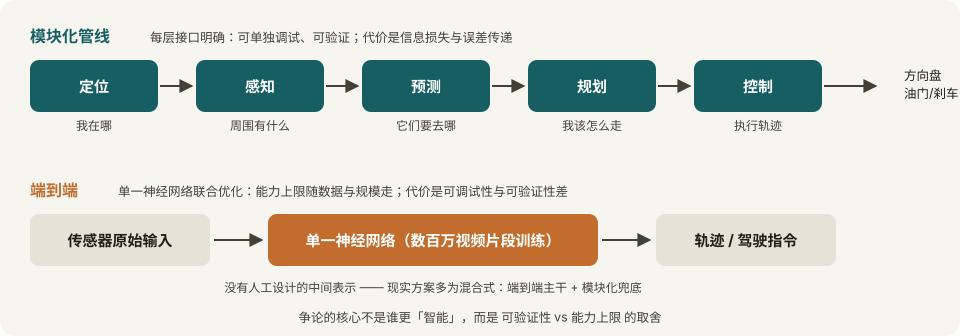

<small>Facts follow the Chinese original.</small>

> [!info] About this page
> A minimal technology map: a place to hang the terms that appear in the history and company notes. The convention is the same as across the whole site: facts and company claims are labeled separately. Information as of 2026-11-11.

## The classic modular pipeline

Localization → **Perception** (what is around me) → **Prediction** (what will they do next) → **Planning** (how should I go) → **Control** (turning the trajectory into steering / throttle / braking), with each module connected by explicit interfaces (e.g., perception outputs an object list, planning outputs a trajectory), and the closed loop running at about 10–30 Hz.

- Strengths: each layer can be debugged and verified separately, and when something goes wrong it can be localized to a module.
- Weaknesses: information loss and error propagation between modules; rules and heuristics pile up, and the long tail is handled by patching.
- Source: [The AI Compendium: Autonomous Vehicles](https://www.theaicompendium.com/12-robotics/autonomous-vehicles.html)

## End-to-end: another way to organize it

A single neural network goes directly from sensor input to driving commands (or a trajectory), with no human-designed intermediate representation.

- Strengths: joint optimization, and the capability ceiling moves with data and model scale.
- Weaknesses: poor debuggability and verifiability — regulation and safety argumentation become harder (see [[regulation/levels-and-rules|Levels and regulation]]).
- In practice, most forms are hybrid: an end-to-end backbone + modular fallback, or a "fast-slow dual system" (such as Li Auto's end-to-end + VLM dual system, see [[technology/routes|The route debate]]).

The core of the debate is not who is more "intelligent," but the trade-off between **verifiability vs. capability ceiling** — which is also why it is entangled with levels and liability questions.

*Comparison of the two ways of organizing the system (drawn by this site): the modular pipeline cuts the problem into five segments with explicit interfaces; end-to-end compresses the five segments into one network. Most real-world solutions lie somewhere in between.*

## Maps: from heavy HD maps to "light maps"

- The early L4 route (represented by Waymo) relied on **HD maps**: first survey the service area to centimeter level, and the car localizes itself on the map in real time to make decisions. The cost is collection cost, freshness of updates, and speed of expansion.
- From 2023, the Chinese market collectively shifted to "heavy perception, light maps": Huawei ADS 2.0 (2023-04) claimed to "not rely on HD maps," and XPeng, Li Auto, NIO, BYD, and others successively followed with mapless / light-map city NOA. The driver was precisely the cost and coverage scalability of HD maps.
- Note on wording: **"light map ≠ no map"** — navigation-level maps are still used for route planning, while local topology and lane information are instead built in real time by bird's-eye view (BEV) + Transformer perception. Vendors' claims of "100% mapless" are company claims.
- Sources: [CLS (2023)](https://www.cls.cn/detail/1397979); [Gasgoo (2024)](https://auto.gasgoo.com/news/202405/29I70393899C106.shtml)

## Training compute: the shutdown of Dojo is a signal

- **Tesla Dojo shutdown** (verified, media reporting): Bloomberg reported on 2025-08-07 that Tesla had disbanded the Dojo team and shut down the in-house training supercomputer project, with its lead departing; Musk subsequently said on X that Dojo 2 was "an evolutionary dead end," and that the compute route would shift to the AI6 chip + externally purchased GPU clusters. Source: [TechCrunch (2025-08-07)](https://techcrunch.com/2025/08/07/tesla-shuts-down-dojo-the-ai-training-supercomputer-that-musk-said-would-be-key-to-full-self-driving/)
- Limits of interpretation: this is a contraction of the "in-house training chip" route, not a decline in compute demand — over the same period, purchases of NVIDIA GPUs by various companies were all increasing. Claims in early 2026 about a "Dojo3 restart" have appeared only in secondary reporting and are not adopted by this site.
- **NVIDIA DRIVE Thor**: a centralized in-vehicle compute platform based on the Blackwell architecture. The adopters / partners listed in NVIDIA's official press release include BYD, XPeng, Li Auto, Zeekr, and WeRide, among others, with mass-production vehicles landing from 2025 onward. This page records only the platform and its adopters, and does not pin down compute figures that vary with configuration. Source: [NVIDIA official press release](https://nvidianews.nvidia.com/news/nvidia-drive-powers-next-generation-transportation)

## The supplier layer: the industrial division of labor behind this diagram

- **Mobileye**: founded in 1999, starting with the EyeQ chip + vision perception, listed on the NYSE in 2014, acquired by Intel in 2017 for 15.3 billion US dollars and spun off and re-listed in 2022; Tesla HW1 used its platform, and the two later parted ways in 2016 over differences in deployment approach (see [[companies/tesla|Tesla]]).
- **NVIDIA DRIVE**: released Drive PX in 2015, turning GPU + deep-learning perception into an in-vehicle platform; Tesla HW2 once used Drive PX 2, after which Tesla switched to in-house chips — the relationship between platform vendors and automakers keeps changing.
- **Huawei Qiankun / Momenta**: two forms of supplier in the Chinese market — full-stack in-house development (chip + domain controller + algorithms) and algorithm suppliers embedded in automakers' mass-production vehicles; for details see [[market/consumer-adas|Passenger-car smart driving]].

## Related notes

- [[technology/perception-evolution|Perception paradigm evolution: from object list to occupancy network]]
- [[technology/routes|The route debate: lidar vs. vision-only]]
- [[history/timeline|Timeline overview]]
