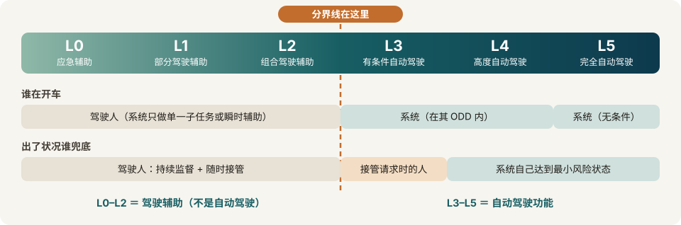

> [!info] 本页任务
> 钉死口径。分级是最容易被宣传话术偷换的概念——先看标准原文怎么说，再看各国怎么批、出了事谁负责。信息截至 2026-11-11。

## SAE J3016：分级在分什么

分级依据**不是「智能程度」**，而是三件事：谁执行动态驾驶任务（DDT，含横向/纵向控制与目标事件检测响应 OEDR）、谁负责 DDT fallback（失效或超限时达到最小风险状态）、以及运行设计域（ODD）的范围。主动安全系统（如 AEB）不在这套分类内。

版本提示：长期通行的是 J3016_202104（2021-04 版）；SAE 现已列出 **J3016_202609**（2026 年 9 月版）。引用时以 [SAE Mobilus 页面](https://saemobilus.sae.org/standards/j3016_202609-taxonomy-definitions-terms-related-driving-automation-systems-road-motor-vehicles)为准，不要再写「最新 = 2021」。

*分级只问三件事：谁开车、谁兜底、在多大范围内（ODD）。L2 与 L3 之间那条线，是「辅助人」与「替代人」的分界（本站绘制）。*

| 级别 | 谁开车 | 谁兜底 | 定性 |
|---|---|---|---|
| L0 | 驾驶人执行全部 DDT，可有警告或瞬时辅助 | 驾驶人 | 驾驶辅助 |
| L1 | 系统在限定 ODD 内持续执行横 **或** 纵单一子任务 | 驾驶人执行其余 DDT、监督并兜底 | 驾驶辅助 |
| L2 | 系统同时执行横向与纵向控制 | **驾驶人仍须持续监督、执行 OEDR 与兜底** | 驾驶辅助 |
| L3 | ADS 在 ODD 内执行全部 DDT | 「fallback-ready user」：不需持续看路，但收到接管请求必须及时响应 | 自动驾驶 |
| L4 | ADS 在 ODD 内执行全部 DDT 并自行兜底 | 系统，不期待人类响应 | 自动驾驶 |
| L5 | ADS 在所有人类可应对条件下执行全部 DDT 并兜底 | 系统，无 ODD 限制 | 自动驾驶 |

两个最常见的偷换：
1. **L0–L2 统称「驾驶辅助」，不是自动驾驶**——把 L2 功能叫「自动驾驶」在分级上就不成立。Tesla FSD 的监管定性始终是 L2，其文件自述见 [[companies/tesla|Tesla]]。
2. **「L2+/L2.5/L2.9」不是 J3016 术语**：标准 §8.3 明确禁止分数式等级表述。这类说法全是营销自创。来源：[Koopman 的 J3016 使用指南](http://users.ece.cmu.edu/~koopman/j3016/index.html)

## 中国国标：GB/T 40429-2021

2021-08-20 发布、2022-03-01 实施。结构与 J3016 对应：0–2 级为「驾驶辅助」（驾驶人仍是驾驶主体），3–5 级为「自动驾驶」。各级名称：0 应急辅助 / 1 部分驾驶辅助 / 2 组合驾驶辅助 / 3 有条件自动驾驶 / 4 高度自动驾驶 / 5 完全自动驾驶。来源：[国家标准全文公开系统](https://openstd.samr.gov.cn/bzgk/std/newGbInfo?hcno=4754CB1B7AD798F288C52D916BFECA34)

## L3 的真实落地：全球只有几款车，且都有严格围栏

- **Honda Legend（日本，全球第一个型式指定）**：2020-11-11 获日本国土交通省型式指定；2021-03-05 上市，**仅租赁、限量 100 台**，场景为高速公路拥堵、车速 <50 km/h。
- **Mercedes Drive Pilot（首个 UN-R157 国际批准）**：2021-12-09 获德国 KBA 依据 UN Regulation No. 157 的型式批准；2023 年获内华达州合规确认与加州 DMV 部署许可，年底在美国上市（EQS/S 级，≤40 mph）。来源：[Mercedes-Benz USA 新闻稿](https://media.mbusa.com/news/mercedes-benz-receives-approvals-for-turquoise-colored-automated-driving-marker-lights-in-california-and-nevada)
  - 注：有二手来源称奔驰在 2026 款改款上撤下 Drive Pilot 并于 2026 年 1 月「暂停」该项目——**未获奔驰官方确认**，本页仅记录有此报道。
- **中国首批（2025-12-15）**：工信部第 401 批《公告》附条件许可**首批 2 款 L3 车型**——长安牌 SC7000AAARBEV（深蓝 SL03，重庆限定路段、拥堵场景单车道、最高 50 km/h）与极狐牌 BJ7001A61NBEV（极狐阿尔法 S6，北京限定高速路段、最高 80 km/h），由长安车联、北京出行两家**使用主体**开展上路通行试点。注意三个限定：附条件、由使用主体运营、**非直接面向消费者销售**。2025-12-23 北京发放首批 L3 高速自动驾驶专用号牌。来源：[工信部原文](https://www.miit.gov.cn/xwfb/gxdt/sjdt/art/2025/art_f734c7074580470593d4018742997640.html)
- **第二批**：2026-10-22 工信部官员在世界智能网联汽车大会上确认「第二批准入试点工作正在进行」，但未披露车企、车型与时间表。截至 2026-11-11，网络流传的入围名单均属推测，本站不采。来源：[CnEVPost（2026-10-22）](https://cnevpost.com/2026/10/22/china-advances-2nd-batch-level-3-approvals/)

## 三套监管框架

**美国：没有综合性联邦自动驾驶法**
- 联邦层面 NHTSA 管车辆安全标准；驾驶人许可、交通规则、保险、登记由各州管辖。议会层面的 AV 法案（SELF DRIVE Act 等）均未成为法律。
- 州拼布的典型形态：加州是 DMV 测试/部署许可 + 保险保证的强监管模式；亚利桑那、内华达相对宽松；得州在立法中把 ADS 本身界定为「operator」。加州对 Cruise 的暂停许可（2023）与对 Tesla 的广告裁决（2025）都是这套州权在起作用，见 [[companies/tesla|Tesla]]。
- **NHTSA 碰撞报告令（SGO 2021-01）的 2025 年变化**：2025-04-24 随交通部 AV Framework 发布第三次修订，2025-06-16 生效——报告义务**被保留但简化**：同一事故只由一个主体报告、严重事故报告合并为单一 5 天窗口、月度报告范围收窄。安全倡导方称之为「削弱」，属定性之争，与事实变化分开看。来源：[NHTSA 致国会报告（2025-07）](https://www.nhtsa.gov/document/report-congress-research-and-rulemaking-vehicles-equipped-automated-driving-systems-july)

**欧洲：型式批准路线**
- **UN-R157（ALKS）**：首个国际层面的 L3 法规，2021-01-22 生效，初始适用高速公路型道路、≤60 km/h，并强制要求 DSSAD（自动驾驶数据存储系统，即「黑匣子」）——Drive Pilot 的德国批准即依据此规。
- **德国 L4 立法**：《自动驾驶法》2021-07-28 生效，允许 L4 在经批准的限定区域内无人运行，型式批准由 KBA 负责。
- **欧盟 (EU) 2022/1426**：在框架法规下为完全自动驾驶车辆（L4 型）的 ADS 制定统一型式批准程序，现阶段仅适用于小批量车辆。

**中国：试点准入路线**
- 总框架是 2023 年四部门准入和上路通行试点通知，路径为「申报遴选 → 产品准入 → 指定主体上路试点」，与地方运营许可、地方条例（如北京 2025 年施行的《自动驾驶汽车条例》）叠合。细节见 [[china/robotaxi-china|中国 Robotaxi 格局]] 的政策部分。

## 责任：分级本身就是责任分配表

- **L0–L2**：驾驶座上的人对监控与守法负责——Tesla 官方表述与各州法一致，所以 L2 事故的诉讼焦点总是「驾驶员有没有在监督」与「营销有没有让人以为不用监督」。
- **L3**：ADS 激活时由系统执行 DDT，但 fallback-ready user 保留接管义务，责任**并非完全转移**；UN-R157 强制 DSSAD 的立法目的之一，就是为事故后的责任归因留数据。
- **L4**：在 ODD 内不预期人类兜底，责任主体转向运营方/系统方——这也是 robotaxi 运营商必须持牌、投保、接受报告义务的原因。
- 关于「奔驰承诺为 Drive Pilot 激活期间事故担责」「Honda 在 Traffic Jam Pilot 激活时由厂商担责」等具体表态：本次调研仅见二手转述，未找到厂商或监管一手文本，本页标注**未核实**，不作为事实陈述。

## 相关笔记

- [[companies/tesla|Tesla]] · [[china/robotaxi-china|中国 Robotaxi 格局]]
- [[regulation/us-eu-rules|美国与欧盟的监管]] · [[technology/consumer-adas|乘用车智驾：卖给车主的辅助驾驶]] · [[timeline|时间线总览]]
