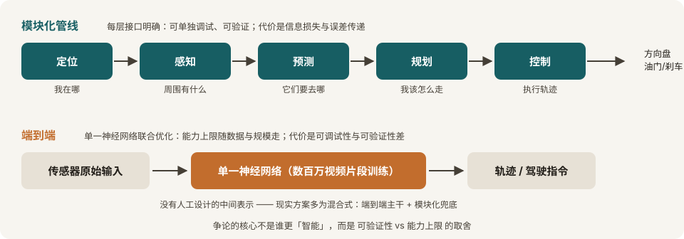

> [!info] 本页定位
> 一张最小技术地图：让历史与公司笔记里的名词有地方挂。口径同全站：事实与公司主张分开标注。信息截至 2026-11-11。

## 经典模块化管线

定位 → **感知**（周围有什么）→ **预测**（它们接下来会做什么）→ **规划**（我该怎么走）→ **控制**（把轨迹变成方向盘/油门/刹车），各模块以明确接口串联（如感知输出目标列表、规划输出轨迹），闭环以约 10–30 Hz 运行。

- 强项：每层可单独调试、可验证、出了问题能定位到模块。
- 弱项：模块之间的信息损失与误差传递；规则与启发式越堆越多，长尾靠打补丁。
- 来源：[The AI Compendium: Autonomous Vehicles](https://www.theaicompendium.com/12-robotics/autonomous-vehicles.html)

## 端到端：另一种组织方式

单一神经网络从传感器输入直接到驾驶指令（或轨迹），没有人工设计的中间表示。

- 强项：联合优化、能力上限随数据与模型规模走。
- 弱项：可调试性与可验证性差——监管与安全论证更难做（见 [[regulation/levels-and-rules|分级与监管]]）。
- 现实形态多为混合式：端到端主干 + 模块化兜底，或「快慢双系统」（如理想的端到端 + VLM 双系统，见 [[technology/routes|路线之争]]）。

争论的核心不是谁更「智能」，而是**可验证性 vs 能力上限**的取舍——这也是它和分级、责任问题缠在一起的原因。

*两种组织方式对照（本站绘制）：模块化管线把问题切成五段明确的接口；端到端把五段压进一个网络。现实方案大多在两者之间。*

## 地图：从重高精地图到「轻图」

- 早期 L4 路线（以 Waymo 为代表）依赖**高精地图**：先把运营区域测绘到厘米级，车实时定位在图上做决策。代价是采集成本、更新鲜度与扩展速度。
- 中国市场 2023 年起集体转向「重感知、轻地图」：华为 ADS 2.0（2023-04）宣称「不依赖高精地图」，小鹏、理想、蔚来、比亚迪等陆续跟进无图/轻图城市 NOA。动因就是高精地图的成本与覆盖扩展性。
- 注意口径：**「轻图 ≠ 无地图」**——导航级地图仍用于路线规划，局部拓扑与车道信息改由 BEV+Transformer 感知实时构建。厂商口中的「100% 无图」属公司主张。
- 来源：[财联社（2023）](https://www.cls.cn/detail/1397979)；[盖世汽车（2024）](https://auto.gasgoo.com/news/202405/29I70393899C106.shtml)

## 训练算力：Dojo 的关停是一个信号

- **Tesla Dojo 关停**（已核实，媒体报道）：Bloomberg 2025-08-07 报道特斯拉解散 Dojo 团队、关闭该自研训练超算项目，负责人离职；Musk 随后在 X 称 Dojo 2 是「一条进化的死胡同」，算力路线转向 AI6 芯片 + 外购 GPU 集群。来源：[TechCrunch（2025-08-07）](https://techcrunch.com/2025/08/07/tesla-shuts-down-dojo-the-ai-training-supercomputer-that-musk-said-would-be-key-to-full-self-driving/)
- 解读边界：这是「自研训练芯片」路线的收缩，不等于算力需求下降——同期各家对 NVIDIA GPU 的采购都在加码。2026 年初「Dojo3 重启」的说法仅见二手报道，本站不采。
- **NVIDIA DRIVE Thor**：Blackwell 架构的集中式车载计算平台，NVIDIA 官方新闻稿列出的采用/合作方包括比亚迪、小鹏、理想、极氪及文远知行等，量产车自 2025 年起落地。本页只记平台与采用方，不写死随配置变化的算力数字。来源：[NVIDIA 官方新闻稿](https://nvidianews.nvidia.com/news/nvidia-drive-powers-next-generation-transportation)

## 供应商层：这张图背后的产业分工

- **Mobileye**：1999 年创立，EyeQ 芯片 + 视觉感知起家，2014 年纽交所上市，2017 年被 Intel 以 153 亿美元收购、2022 年再分拆上市；Tesla HW1 用的就是它的平台，后因部署方式分歧于 2016 年分手（见 [[companies/tesla|Tesla]]）。
- **NVIDIA DRIVE**：2015 年发布 Drive PX，把 GPU + 深度学习感知做成车载平台；Tesla HW2 曾采用 Drive PX 2，之后 Tesla 转自研芯片——平台商与整车厂的关系一直在变。
- **华为乾崑 / Momenta**：中国市场的两种供应商形态——全栈自研（芯片+域控+算法）与算法供应商嵌入车厂量产车，细节见 [[china/robotaxi-china|中国 Robotaxi 格局]] 的量产辅助驾驶部分。

## 相关笔记

- [[technology/routes|路线之争：激光雷达 vs 纯视觉]]
- [[timeline|时间线总览]]
